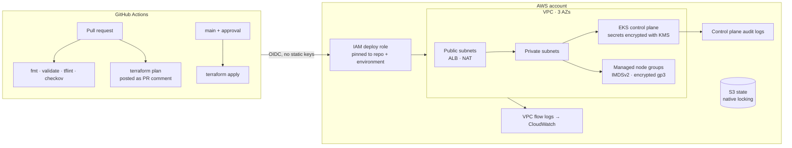

# terraform-aws-eks-platform

[](https://github.com/Captainpeace6/terraform-aws-eks-platform/actions/workflows/ci.yml)

Production-style AWS platform in Terraform: a multi-AZ VPC, an EKS cluster with managed node groups, and a GitHub Actions pipeline that deploys with short-lived OIDC credentials. Separate `dev` and `prod` environments (one AWS account each) share the same modules with different sizing and security posture.

## Architecture



## What's in it

| Path | What it does |
|---|---|
| `modules/vpc` | VPC across 3 AZs, public/private subnets tagged for the AWS Load Balancer Controller, NAT per AZ or shared, default SG locked down, flow logs to KMS-encrypted CloudWatch |
| `modules/eks` | EKS control plane (private endpoint, all control plane logs, KMS secrets encryption, API auth mode), IRSA OIDC provider, managed node groups through launch templates (IMDSv2 required, hop limit 1, encrypted gp3), core add-ons |
| `modules/github-oidc` | IAM role GitHub Actions assumes through OIDC, scoped to one repo and one GitHub environment |
| `envs/dev` | Cheap: single NAT, Spot nodes, public API limited to a CIDR allowlist |
| `envs/prod` | HA: NAT per AZ, on-demand system + app node pools, private-only API |

## Pipeline

| Workflow | Trigger | Does |
|---|---|---|
| `ci.yml` | every push and PR | `terraform fmt`, `validate` for both environments, TFLint, Checkov security scan |
| `deploy.yml` | PR / manual | plans both environments and comments the plan on the PR; applies the reviewed plan from `main` through a GitHub environment (prod requires approval) |
| `drift.yml` | weekly | `plan -detailed-exitcode` against real infrastructure and opens an issue if something changed outside Terraform |

`deploy.yml` and `drift.yml` stay skipped until the repo has the `AWS_ROLE_ARN_DEV`, `AWS_ROLE_ARN_PROD` and `TF_STATE_BUCKET` variables, so the pipeline is green without an AWS account attached.

## Security decisions

- **No long-lived AWS keys.** CI gets 1-hour credentials through GitHub OIDC, and the trust policy only accepts tokens from this repo's `dev`/`prod` environments.
- **Private by default.** Nodes live in private subnets; the prod API endpoint is private-only.
- **Encryption everywhere.** One customer-managed KMS key per environment with rotation on, used for Kubernetes secrets, node volumes and log groups.
- **Node metadata locked down.** IMDSv2 is required with a hop limit of 1, so pods can't borrow the node's IAM role; workloads use IRSA or Pod Identity instead.
- **Every Checkov skip is justified in code** next to the resource, not hidden in a global ignore file.

## Usage

```bash
cd envs/dev
cp backend.hcl.example backend.hcl   # set your state bucket
terraform init -backend-config=backend.hcl
terraform plan
terraform apply

# then
$(terraform output -raw kubeconfig_command)
kubectl get nodes
```

> **Cost:** dev runs roughly $200–250/month (EKS control plane, one NAT gateway, two Spot nodes). Run `terraform destroy` when you're done experimenting.

## Requirements

- Terraform >= 1.10 (S3 native state locking)
- AWS provider ~> 5.60
